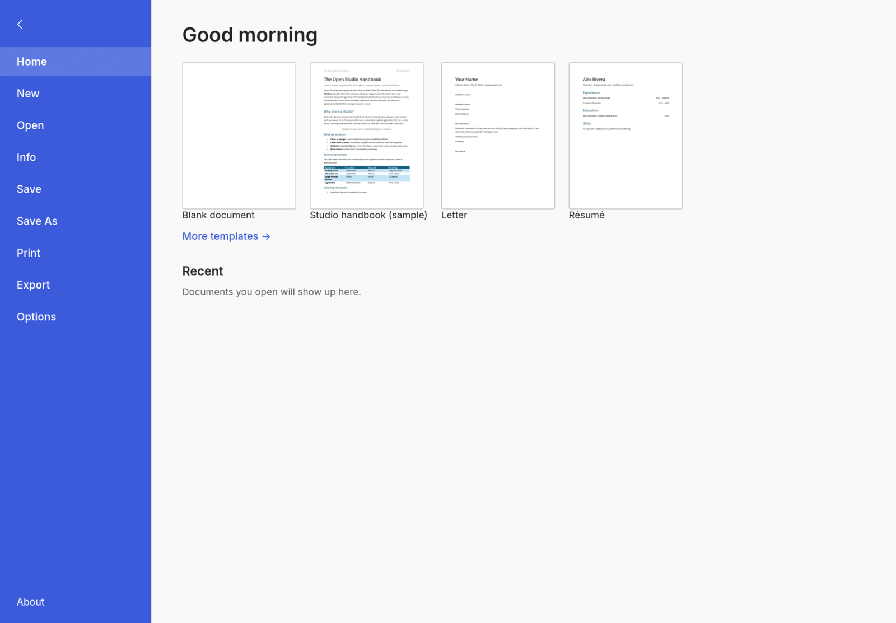

# WordCraft for iPadOS (fork)

<p align="center">
  
  <br>
  <sub>WordCraft on iPadOS, in landscape (iPad Air 11-inch simulator).</sub>
</p>

This fork exists only for the **iPadOS port** of WordCraft, an open-source, clean-room word processor
written in Rust. To learn about the project itself (features, file formats, desktop and web builds,
downloads, the other Crafting Apps, contributing), read the upstream README:
**[storytold/wordcraft](https://github.com/storytold/wordcraft#readme)**.

## What this fork adds

- **`apps/wordcraft-ios`**: a Rust static-library runner (single UIKit window scene attached to winit's
  window, safe-area insets taken from UIKit every frame, UIDocumentPicker behind WordCraft's `file_dialog`
  service, preferences in the app container). Open imports a snapshot into the app container and
  remembers where the file came from; Save As reserves a file there, and a change tracker takes each saved
  document to the export picker the first time and to the remembered location after.
- **`packaging/ios`**: the Xcode project that links the library into an iPad app bundle, with a bundle
  validator and tests. See its [README](packaging/ios/README.md).
- **`cargo xtask ios`**: build, install and launch on the Simulator or a physical iPad
  (`--sim`, `--device --device-id <id> --team <id> [--bundle-id <dev id>]`).
- **No Discord links.** The title-bar button and its option, the Help and File entries, the About link and
  the strings in every language are gone.

## Status

Verified in the iPad Air 11-inch M3 simulator (iPadOS 26.2): the app builds, installs, launches, shows the
Start screen in landscape and keeps the UI inside the safe area. Host tests cover the runner's preferences,
storage and change tracking.

User-reported on a physical iPad Air 13-inch (M3), Debug build (2026-10-13), not instrumented: Open and Save
work through the Files picker, and touch works.

**Not yet verified:** typing with an external keyboard (the intended way to use WordCraft on an iPad) and its
shortcuts, Apple Pencil, multitasking, Release builds. The on-screen keyboard is a low priority and is not
specially supported. Printing, folder access and the system clipboard are not wired up. This is a first
bootstrap, not a hardware sign-off.

## Build and run

Requires macOS with Xcode and the Rust targets `aarch64-apple-ios`, `aarch64-apple-ios-sim` and
`x86_64-apple-ios`.

```sh
cargo xtask ios --sim          # build, boot, install and launch on the iPad simulator
cargo xtask ios --device --device-id <udid> --team <team id> --bundle-id <your.dev.bundle.id>
cargo test -p wordcraft-ios --lib
python3 -m unittest discover -s packaging/ios/tests -v
```

Contributor rules (clean-room, never crash, layering, assets) are in [`AGENTS.md`](AGENTS.md).

## License and attribution

Dual-licensed MIT OR Apache-2.0, as upstream. Assets are listed in [`ATTRIBUTION.md`](ATTRIBUTION.md).
